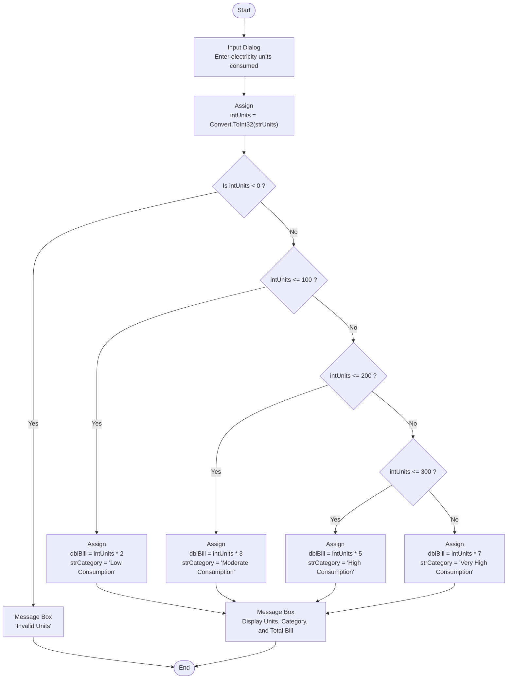

# Exercise 1: Electricity Bill Calculation Using If

## 1. Aim
To develop a UiPath workflow to calculate the electricity bill based on the number of units consumed using nested **If** activities in UiPath Studio.

---

## 2. Workflow Specifications
- **Software**: UiPath Studio
- **Project Type**: Windows (.NET 6 / .NET 8 / .NET 10)
- **Expression Language**: VB.NET
- **Workflow Type**: `Sequence`
- **Dependencies**: `UiPath.System.Activities`, `UiPath.UIAutomation.Activities`

---

## 3. Variables & Data Types
The workflow defines four variables scoped to the main sequence:

| Variable Name | Data Type | Default Value | Scope | Description |
| :--- | :--- | :--- | :--- | :--- |
| `strUnits` | `System.String` | *(None)* | Main Sequence | Stores the raw string input entered by the user via Input Dialog. |
| `intUnits` | `System.Int32` | *(None)* | Main Sequence | Stores the parsed integer value of units consumed. |
| `dblBill` | `System.Double` | `0` | Main Sequence | Stores the calculated bill amount in Rupees. |
| `strCategory` | `System.String` | *(None)* | Main Sequence | Stores the consumption category description. |

---

## 4. Tariff Structure & Logic
A flat rate is applied to all units based on the consumption tier:

| Units Consumed | Rate per Unit | Category Classification | Calculation Formula |
| :--- | :--- | :--- | :--- |
| **0 – 100** | ₹2 / unit | Low Consumption | `dblBill = intUnits * 2` |
| **101 – 200** | ₹3 / unit | Moderate Consumption | `dblBill = intUnits * 3` |
| **201 – 300** | ₹5 / unit | High Consumption | `dblBill = intUnits * 5` |
| **Above 300** | ₹7 / unit | Very High Consumption | `dblBill = intUnits * 7` |
| **< 0** | *N/A* | Invalid Units | Triggers error Message Box: *"Invalid Units"* |

---

## 5. Step-by-Step Procedure

1. **Create Sequence Workflow**:
   - Open UiPath Studio, create a new process named `Exercise_01_Electricity_Bill_Calculation`.
   - In `Main.xaml`, add a **Sequence** activity and name it `Main Sequence - Electricity Bill Calculation`.

2. **Input Dialog (Get Units Consumed)**:
   - Drag and drop an **Input Dialog** activity.
   - Set **Title**: `"Electricity Bill Calculation"`
   - Set **Label**: `"Enter electricity units consumed"`
   - Set **Result** output variable: `strUnits`

3. **Assign (Data Type Conversion)**:
   - Add an **Assign** activity:
     - **Save to**: `intUnits`
     - **Value to save**: `Convert.ToInt32(strUnits)`

4. **Input Validation (If Negative Units)**:
   - Add an **If** activity with condition:
     ```vb
     intUnits < 0
     ```
   - **Then Section**:
     - Add a **Message Box** activity with Text: `"Invalid Units"`.

5. **Nested If Activities (Classification & Calculation)**:
   - In the **Else Section** of the validation activity, add nested **If** activities:
     - **If Condition 1**: `intUnits <= 100`
       - **Then**:
         - Assign `dblBill = intUnits * 2`
         - Assign `strCategory = "Low Consumption"`
       - **Else**:
         - Add another **If** with condition: `intUnits <= 200`
           - **Then**:
             - Assign `dblBill = intUnits * 3`
             - Assign `strCategory = "Moderate Consumption"`
           - **Else**:
             - Add another **If** with condition: `intUnits <= 300`
               - **Then**:
                 - Assign `dblBill = intUnits * 5`
                 - Assign `strCategory = "High Consumption"`
               - **Else**:
                 - Assign `dblBill = intUnits * 7`
                 - Assign `strCategory = "Very High Consumption"`

6. **Display Result**:
   - Immediately following the nested If structure inside the valid branch, add a **Message Box** activity with the expression:
     ```vb
     "Units Consumed: " & intUnits.ToString & vbCrLf & _
     "Category: " & strCategory & vbCrLf & _
     "Electricity Bill: Rs. " & dblBill.ToString("F2")
     ```

---

## 6. Workflow Architecture Diagram



---

## 7. How to Open and Run in UiPath Studio

1. Open **UiPath Studio**.
2. Click **Open Project** on the home screen.
3. Browse to `d:\7sem\rpa\experiment\Exercise_01_Electricity_Bill_Calculation` and select `project.json`.
4. Wait for UiPath Studio to restore project dependencies (`UiPath.System.Activities`).
5. Open `Main.xaml` from the **Project** panel.
6. Click the **Debug / Run** dropdown and select **Run File** (or press `F6`).
7. Enter a unit value in the input dialog prompt (e.g., `250`) and click **OK**.
8. Inspect the resulting Message Box.

---

## 8. Test Cases & Execution Results

| Test Case | Input (`strUnits`) | Parsed `intUnits` | Expected Category | Expected Bill | Output Display |
| :---: | :---: | :---: | :---: | :---: | :--- |
| **TC-01** | `80` | `80` | Low Consumption | ₹160.00 | Units Consumed: 80<br>Category: Low Consumption<br>Electricity Bill: Rs. 160.00 |
| **TC-02** | `150` | `150` | Moderate Consumption | ₹450.00 | Units Consumed: 150<br>Category: Moderate Consumption<br>Electricity Bill: Rs. 450.00 |
| **TC-03** | `250` | `250` | High Consumption | ₹1,250.00 | Units Consumed: 250<br>Category: High Consumption<br>Electricity Bill: Rs. 1,250.00 |
| **TC-04** | `350` | `350` | Very High Consumption | ₹2,450.00 | Units Consumed: 350<br>Category: Very High Consumption<br>Electricity Bill: Rs. 2,450.00 |
| **TC-05** | `-10` | `-10` | *None* | *None* | Message Box: `Invalid Units` |

---

## 9. Key RPA Concepts Demonstrated
- **Conditional Branching (`If`)**: Implementing single-alternative, dual-alternative, and multi-alternative nested decision trees.
- **Data Type Casting**: Converting user text input into numeric data types using `Convert.ToInt32()`.
- **Formatting Expressions**: Formatting numeric values to fixed-point currency strings using `.ToString("F2")`.
- **String Concatenation & Line Breaks**: Combining strings with `&` and system line separators `vbCrLf`.

---

## 10. Troubleshooting & Common Pitfalls
- **FormatException**: Occurs if the user enters non-numeric text (e.g., `"abc"`). In production, wrap conversion in a `Try Catch` or use `Int32.TryParse()`.
- **Scope Misalignment**: Ensure variables `dblBill` and `strCategory` are defined at the root sequence level so their values persist into the Message Box activity.\n