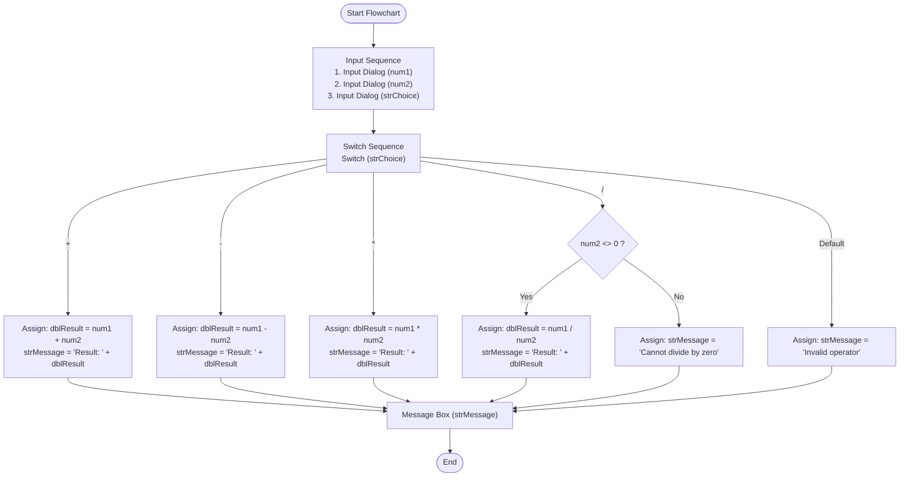

# Exercise 2: Simple Calculator Using Switch

## 1. Aim
To develop a UiPath workflow using a **Flowchart** and a **Switch** activity to perform basic arithmetic operations (`+`, `-`, `*`, `/`) with division-by-zero protection.

---

## 2. Workflow Specifications
- **Software**: UiPath Studio
- **Project Type**: Windows (.NET 6 / .NET 8 / .NET 10)
- **Expression Language**: VB.NET
- **Workflow Type**: `Flowchart`
- **Dependencies**: `UiPath.System.Activities`, `UiPath.UIAutomation.Activities`

---

## 3. Variables & Data Types

| Variable Name | Data Type | Default Value | Scope | Description |
| :--- | :--- | :--- | :--- | :--- |
| `strInput` | `System.String` | *(None)* | Flowchart | Buffer variable storing string responses from Input Dialogs. |
| `num1` | `System.Double` | *(None)* | Flowchart | First numeric operand. |
| `num2` | `System.Double` | *(None)* | Flowchart | Second numeric operand. |
| `strChoice` | `System.String` | *(None)* | Flowchart | Operator symbol selected by user (`+`, `-`, `*`, `/`). |
| `dblResult` | `System.Double` | *(None)* | Flowchart | Computed numerical result. |
| `strMessage` | `System.String` | *(None)* | Flowchart | Formatted output message or error string. |

---

## 4. Step-by-Step Procedure

1. **Create Flowchart Workflow**:
   - In `Main.xaml`, use a **Flowchart** activity named `Flowchart - Simple Calculator`.

2. **Input Sequence Node**:
   - Add a **Sequence** activity named `Input Sequence` and connect the Flowchart **StartNode** to it.
   - Inside `Input Sequence`:
     1. Add an **Input Dialog** for the first number:
        - Title: `"Simple Calculator"`
        - Label: `"Enter first number:"`
        - Result: `strInput`
     2. Add an **Assign** activity:
        - `num1 = Convert.ToDouble(strInput)`
     3. Add an **Input Dialog** for the second number:
        - Title: `"Simple Calculator"`
        - Label: `"Enter second number:"`
        - Result: `strInput`
     4. Add an **Assign** activity:
        - `num2 = Convert.ToDouble(strInput)`
     5. Add an **Input Dialog** for the operator:
        - Title: `"Simple Calculator"`
        - Label: `"Choose operator (+, -, *, /):"`
        - Result: `strChoice`

3. **Switch Sequence Node**:
   - Add a second FlowStep with a **Sequence** named `Switch Sequence` connected from the `Input Sequence`.
   - Inside `Switch Sequence`, add a **Switch (Of String)** activity:
     - **Expression**: `strChoice.Trim()`
     - **Default Case**:
       - Assign `strMessage = "Invalid operator"`
     - **Case `"+"`**:
       - Assign `dblResult = num1 + num2`
       - Assign `strMessage = "Result: " & dblResult.ToString()`
     - **Case `"-"`**:
       - Assign `dblResult = num1 - num2`
       - Assign `strMessage = "Result: " & dblResult.ToString()`
     - **Case `"*"`**:
       - Assign `dblResult = num1 * num2`
       - Assign `strMessage = "Result: " & dblResult.ToString()`
     - **Case `"/"`**:
       - Add an **If** activity with condition:
         ```vb
         num2 <> 0
         ```
       - **Then**:
         - Assign `dblResult = num1 / num2`
         - Assign `strMessage = "Result: " & dblResult.ToString()`
       - **Else**:
         - Assign `strMessage = "Cannot divide by zero"`

4. **Result Message Box Node**:
   - Add a FlowStep containing a **Message Box** activity:
     - Text: `strMessage`
   - Connect the output of `Switch Sequence` to this Message Box node.

---

## 5. Workflow Architecture Diagram



---

## 6. How to Open and Run in UiPath Studio

1. Open UiPath Studio.
2. Select **Open Project** and navigate to `d:\7sem\rpa\experiment\Exercise_02_Simple_Calculator_Switch`.
3. Open `Main.xaml`.
4. Click **Run File** (`F6`).
5. Enter the first number, second number, and operation when prompted.
6. Observe the resulting calculation or error message.

---

## 7. Test Cases & Execution Results

| Test Case | Input 1 (`num1`) | Input 2 (`num2`) | Operator (`strChoice`) | Expected Output (`strMessage`) |
| :---: | :---: | :---: | :---: | :--- |
| **TC-01** | `20` | `10` | `+` | `Result: 30` |
| **TC-02** | `50` | `15` | `-` | `Result: 35` |
| **TC-03** | `12` | `4` | `*` | `Result: 48` |
| **TC-04** | `100` | `4` | `/` | `Result: 25` |
| **TC-05** | `25` | `0` | `/` | `Cannot divide by zero` |
| **TC-06** | `10` | `5` | `%` | `Invalid operator` |

---

## 8. Key RPA Concepts Demonstrated
- **Flowchart Control Flow**: Non-linear modular execution connecting sequential nodes and branching logic.
- **`Switch (Of T)` Activity**: Direct multi-way branch selection without cascading nested If blocks.
- **Arithmetic Edge Case Handling**: Explicit guard statements checking for zero divisors.\n