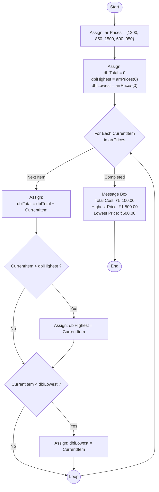

# Exercise 3: Product Price Analysis Using Array

## 1. Aim
To develop a UiPath workflow to store the prices of five products in an array, identify the highest and lowest prices, and calculate the total cost using a **For Each** activity.

---

## 2. Workflow Specifications
- **Software**: UiPath Studio
- **Project Type**: Windows (.NET 6 / .NET 8 / .NET 10)
- **Expression Language**: VB.NET
- **Workflow Type**: `Sequence`
- **Dependencies**: `UiPath.System.Activities`, `UiPath.UIAutomation.Activities`

---

## 3. Variables & Data Types

| Variable Name | Data Type | Default Value | Scope | Description |
| :--- | :--- | :--- | :--- | :--- |
| `arrPrices` | `System.Double[]` | *(None)* | Main Sequence | Fixed-size array containing 5 product prices: `{1200, 850, 1500, 600, 950}`. |
| `dblTotal` | `System.Double` | `0` | Main Sequence | Accumulator variable storing the sum of all product prices. |
| `dblHighest` | `System.Double` | `0` | Main Sequence | Stores the highest price found in the array. |
| `dblLowest` | `System.Double` | `0` | Main Sequence | Stores the lowest price found in the array. |

---

## 4. Step-by-Step Procedure

1. **Initialize Array**:
   - Add an **Assign** activity:
     - **To**: `arrPrices`
     - **Value**: `New Double() {1200, 850, 1500, 600, 950}`

2. **Initialize Accumulator & Bounds**:
   - Add an **Assign** activity:
     - `dblTotal = 0`
   - Add an **Assign** activity:
     - `dblHighest = arrPrices(0)`
   - Add an **Assign** activity:
     - `dblLowest = arrPrices(0)`

3. **Iterate Array with For Each**:
   - Add a **For Each** activity:
     - **Values**: `arrPrices`
     - **TypeArgument**: `System.Double`
     - **Current Item Variable**: `CurrentItem`

4. **Loop Body Actions**:
   - Inside the loop body:
     1. **Accumulate Total**:
        - Assign: `dblTotal = dblTotal + CurrentItem`
     2. **Check Highest**:
        - Add an **If** activity with condition:
          ```vb
          CurrentItem > dblHighest
          ```
        - **Then**: Assign `dblHighest = CurrentItem`
     3. **Check Lowest**:
        - Add an **If** activity with condition:
          ```vb
          CurrentItem < dblLowest
          ```
        - **Then**: Assign `dblLowest = CurrentItem`

5. **Display Analysis Results**:
   - After the loop completes, add a **Message Box** activity with the expression:
     ```vb
     "Product Price Analysis" & vbCrLf & vbCrLf & _
     "Total Cost: Rs. " & dblTotal.ToString("F2") & vbCrLf & _
     "Highest Price: Rs. " & dblHighest.ToString("F2") & vbCrLf & _
     "Lowest Price: Rs. " & dblLowest.ToString("F2")
     ```

---

## 5. Workflow Architecture Diagram



---

## 6. How to Open and Run in UiPath Studio

1. Open UiPath Studio.
2. Select **Open Project** and navigate to `d:\7sem\rpa\experiment\Exercise_03_Product_Price_Analysis_Array`.
3. Open `Main.xaml`.
4. Press `F6` (**Run File**).
5. The Message Box displays the total cost, highest price, and lowest price immediately.

---

## 7. Execution Results

```text
Product Price Analysis

Total Cost: Rs. 5100.00
Highest Price: Rs. 1500.00
Lowest Price: Rs. 600.00
```

---

## 8. Key RPA Concepts Demonstrated
- **Array Collections**: Instantiating and indexing static 1D arrays using `New Double() {...}`.
- **`For Each` Looping**: Iterating over strongly typed elements with `TypeArgument = Double`.
- **Min / Max Search Algorithm**: Initializing comparisons with index 0 to eliminate edge cases where arbitrary zero initializers skew negative numbers.\n