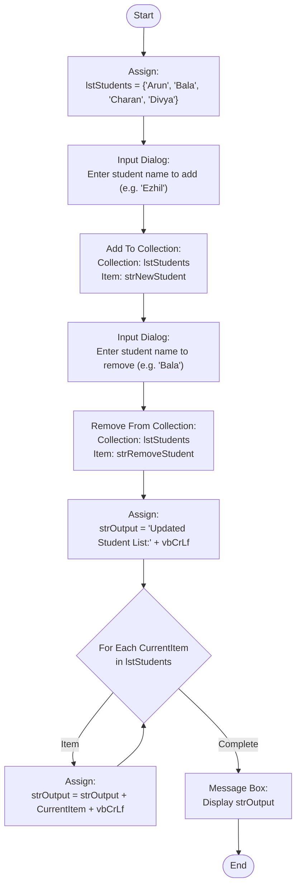

# Exercise 4: Student Name Management Using List Collection

## 1. Aim
To develop a UiPath workflow to add, remove, and display student names dynamically using a generic `List(Of String)` collection.

---

## 2. Workflow Specifications
- **Software**: UiPath Studio
- **Project Type**: Windows (.NET 6 / .NET 8 / .NET 10)
- **Expression Language**: VB.NET
- **Workflow Type**: `Sequence`
- **Dependencies**: `UiPath.System.Activities`, `UiPath.UIAutomation.Activities`

---

## 3. Variables & Data Types

| Variable Name | Data Type | Default Value | Scope | Description |
| :--- | :--- | :--- | :--- | :--- |
| `lstStudents` | `System.Collections.Generic.List(Of String)` | *(None)* | Main Sequence | Dynamic generic collection of student names. |
| `strNewStudent` | `System.String` | *(None)* | Main Sequence | Name of student to add via Input Dialog. |
| `strRemoveStudent`| `System.String` | *(None)* | Main Sequence | Name of student to remove via Input Dialog. |
| `strOutput` | `System.String` | *(None)* | Main Sequence | Formatted output text listing all current students. |

---

## 4. Step-by-Step Procedure

1. **Initialize Generic List**:
   - Add an **Assign** activity:
     - **To**: `lstStudents`
     - **Value**: `New List(Of String) From {"Arun", "Bala", "Charan", "Divya"}`

2. **Input Dialog (Add Student)**:
   - Add an **Input Dialog** activity:
     - **Title**: `"Add Student"`
     - **Label**: `"Enter student name to add:"`
     - **Result**: `strNewStudent`

3. **Add to Collection**:
   - Add an **Add To Collection** activity:
     - **Collection**: `lstStudents`
     - **Item**: `strNewStudent`
     - **TypeArgument**: `String`

4. **Input Dialog (Remove Student)**:
   - Add an **Input Dialog** activity:
     - **Title**: `"Remove Student"`
     - **Label**: `"Enter student name to remove:"`
     - **Result**: `strRemoveStudent`

5. **Remove from Collection**:
   - Add a **Remove From Collection** activity:
     - **Collection**: `lstStudents`
     - **Item**: `strRemoveStudent`
     - **TypeArgument**: `String`

6. **Build Display String**:
   - Add an **Assign** activity:
     - `strOutput = "Updated Student List:" & vbCrLf`

7. **Iterate with For Each**:
   - Add a **For Each** activity:
     - **Values**: `lstStudents`
     - **TypeArgument**: `String`
     - **Body Assign**:
       ```vb
       strOutput = strOutput & CurrentItem & vbCrLf
       ```

8. **Display Result**:
   - Add a **Message Box** activity with Text: `strOutput`.

---

## 5. Workflow Architecture Diagram



---

## 6. How to Open and Run in UiPath Studio

1. Open UiPath Studio.
2. Select **Open Project** and navigate to `d:\7sem\rpa\experiment\Exercise_04_Student_Name_Management_List`.
3. Open `Main.xaml`.
4. Press `F6` (**Run File**).
5. At the first dialog, enter: `Ezhil`.
6. At the second dialog, enter: `Bala`.
7. The Message Box displays the updated student list.

---

## 7. Execution Results

```text
Updated Student List:
Arun
Charan
Divya
Ezhil
```

---

## 8. Key RPA Concepts Demonstrated
- **Dynamic Collections**: Utilizing generic `List(Of T)` collections for run-time size alteration without fixed upper bounds.
- **Collection Activities**: Using built-in UiPath activities `AddToCollection` and `RemoveFromCollection`.
- **String Accumulation**: Constructing multiline report strings dynamically inside iteration loops.\n