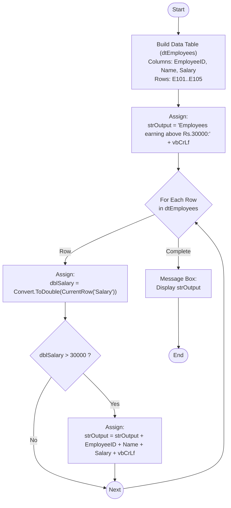

# Exercise 5: Employee Salary Analysis Using DataTable

## 1. Aim
To develop a UiPath workflow to build an in-memory `DataTable` of employees, filter records based on salary (> ₹30,000) using **For Each Row in Data Table**, and display the qualified employees.

---

## 2. Workflow Specifications
- **Software**: UiPath Studio
- **Project Type**: Windows (.NET 6 / .NET 8 / .NET 10)
- **Expression Language**: VB.NET
- **Workflow Type**: `Sequence`
- **Dependencies**: `UiPath.System.Activities`, `UiPath.UIAutomation.Activities`

---

## 3. Variables & Data Types

| Variable Name | Data Type | Default Value | Scope | Description |
| :--- | :--- | :--- | :--- | :--- |
| `dtEmployees` | `System.Data.DataTable` | *(None)* | Main Sequence | In-memory tabular dataset of employees. |
| `dblSalary` | `System.Double` | *(None)* | Main Sequence | Buffer variable holding the converted numerical salary for the current row. |
| `strOutput` | `System.String` | *(None)* | Main Sequence | String buffer accumulating qualified employee records. |

---

## 4. Employee Dataset Schema

| EmployeeID (String) | Name (String) | Salary (Int32) | Salary > 30000 ? |
| :---: | :---: | :---: | :---: |
| `E101` | Arun | 25000 | ❌ No |
| `E102` | Bala | 35000 | ✅ Yes |
| `E103` | Charan | 45000 | ✅ Yes |
| `E104` | Divya | 28000 | ❌ No |
| `E105` | Ezhil | 50000 | ✅ Yes |

---

## 5. Step-by-Step Procedure

1. **Build Data Table Activity**:
   - Add a **Build Data Table** activity.
   - Configure columns:
     - `EmployeeID`: Data Type = `String`, Max Length = `100`
     - `Name`: Data Type = `String`
     - `Salary`: Data Type = `Int32`
   - Insert rows for `E101`, `E102`, `E103`, `E104`, and `E105` with corresponding salaries.
   - Set Output DataTable to `dtEmployees`.

2. **Initialize Output String**:
   - Add an **Assign** activity:
     - `strOutput = "Employees earning above Rs.30000:" & vbCrLf`

3. **Iterate with For Each Row in Data Table**:
   - Add a **For Each Row in Data Table** activity:
     - **DataTable**: `dtEmployees`
     - **Row Variable**: `CurrentRow`

4. **Loop Body Logic**:
   - Inside the loop:
     1. Add an **Assign** activity:
        - `dblSalary = Convert.ToDouble(CurrentRow("Salary"))`
     2. Add an **If** activity with condition:
        ```vb
        dblSalary > 30000
        ```
     3. In the **Then** branch, append row data:
        ```vb
        strOutput = strOutput & CurrentRow("EmployeeID").ToString() & " " & _
                    CurrentRow("Name").ToString() & " Rs." & _
                    dblSalary.ToString() & vbCrLf
        ```

5. **Display Filtered Results**:
   - Add a **Message Box** activity with Text: `strOutput`.

---

## 6. Workflow Architecture Diagram



---

## 7. How to Open and Run in UiPath Studio

1. Open UiPath Studio.
2. Select **Open Project** and navigate to `d:\7sem\rpa\experiment\Exercise_05_Employee_Salary_Analysis_DataTable`.
3. Open `Main.xaml`.
4. Press `F6` (**Run File**).
5. The Message Box displays the filtered list of employees.

---

## 8. Execution Results

```text
Employees earning above Rs.30000:
E102 Bala Rs.35000
E103 Charan Rs.45000
E105 Ezhil Rs.50000
```

---

## 9. Key RPA Concepts Demonstrated
- **Data Table Data Structures**: Utilizing `System.Data.DataTable` for tabular record storage in memory.
- **Schema & Data Population**: Configuring schema columns and sample records with `Build Data Table`.
- **Row-level Iteration**: Accessing column data by name (`CurrentRow("Salary")`) and converting Object types to numeric formats.
- **Conditional Filtering**: Extracting subset records matching business logic conditions.\n