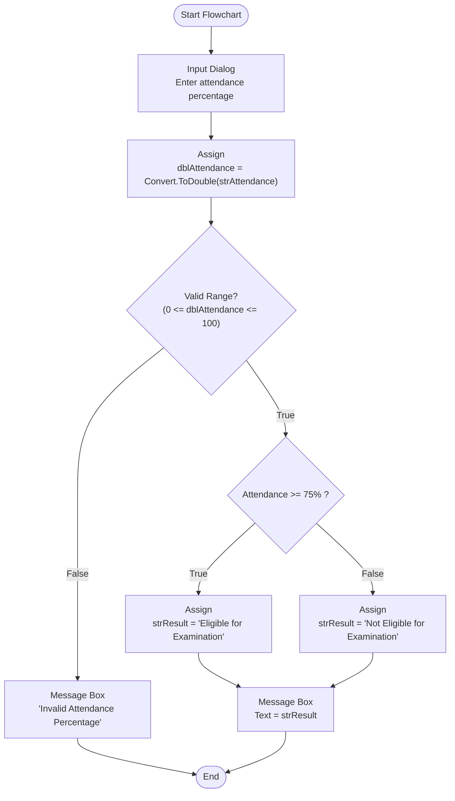

# Exercise 6: Student Attendance Eligibility Using Flowchart

## 1. Aim
To develop a UiPath workflow using a **Flowchart** to check student examination eligibility based on a minimum attendance requirement of **75%**, with comprehensive input range validation (0% to 100%).

---

## 2. Workflow Specifications
- **Software**: UiPath Studio
- **Project Type**: Windows (.NET 6 / .NET 8 / .NET 10)
- **Expression Language**: VB.NET
- **Workflow Type**: `Flowchart`
- **Dependencies**: `UiPath.System.Activities`, `UiPath.UIAutomation.Activities`

---

## 3. Variables & Data Types

| Variable Name | Data Type | Default Value | Scope | Description |
| :--- | :--- | :--- | :--- | :--- |
| `strAttendance` | `System.String` | *(None)* | Flowchart | Raw input string from user via Input Dialog. |
| `dblAttendance` | `System.Double` | *(None)* | Flowchart | Parsed numerical percentage of attendance. |
| `strResult` | `System.String` | *(None)* | Flowchart | Output eligibility status string displayed to the user. |

---

## 4. Step-by-Step Procedure

1. **Create Flowchart Workflow**:
   - In `Main.xaml`, use a **Flowchart** activity named `Flowchart - Attendance Eligibility`.

2. **Input Dialog Node**:
   - Add an **Input Dialog** activity:
     - Title: `"Student Attendance Eligibility"`
     - Label: `"Enter attendance percentage"`
     - Result: `strAttendance`
   - Connect the Flowchart **StartNode** to this activity.

3. **Assign Conversion Node**:
   - Add an **Assign** activity:
     - `dblAttendance = Convert.ToDouble(strAttendance)`
   - Connect the Input Dialog to this Assign step.

4. **Flow Decision 1 (Range Validation)**:
   - Add a **Flow Decision** activity:
     - **DisplayName**: `"Valid Range (0-100)?"`
     - **Condition**:
       ```vb
       dblAttendance >= 0 AndAlso dblAttendance <= 100
       ```
   - Connect Assign to this decision diamond.
   - **False Branch**:
     - Connect to a **Message Box** activity with Text: `"Invalid Attendance Percentage"`.

5. **Flow Decision 2 (Eligibility Check)**:
   - In the **True Branch** of Flow Decision 1, connect to a second **Flow Decision**:
     - **DisplayName**: `"Attendance >= 75%?"`
     - **Condition**:
       ```vb
       dblAttendance >= 75
       ```
   - **True Branch**:
     - Connect to an **Assign** node: `strResult = "Eligible for Examination"`
   - **False Branch**:
     - Connect to an **Assign** node: `strResult = "Not Eligible for Examination"`

6. **Display Result Node**:
   - Add a **Message Box** activity with Text: `strResult`.
   - Connect both the True and False Assign nodes from Step 5 to this Message Box.

---

## 5. Workflow Architecture Diagram



---

## 6. How to Open and Run in UiPath Studio

1. Open UiPath Studio.
2. Select **Open Project** and navigate to `d:\7sem\rpa\experiment\Exercise_06_Student_Attendance_Eligibility_Flowchart`.
3. Open `Main.xaml`.
4. Press `F6` (**Run File**).
5. Enter attendance percentage when prompted (e.g. `82`).
6. Observe the examination eligibility dialog.

---

## 7. Test Cases & Execution Results

| Test Case | Input (`strAttendance`) | Valid Range? | Attendance >= 75%? | Output Message |
| :---: | :---: | :---: | :---: | :--- |
| **TC-01** | `82` | ✅ True | ✅ True | `Eligible for Examination` |
| **TC-02** | `63` | ✅ True | ❌ False | `Not Eligible for Examination` |
| **TC-03** | `75` | ✅ True | ✅ True | `Eligible for Examination` |
| **TC-04** | `105` | ❌ False | *N/A* | `Invalid Attendance Percentage` |
| **TC-05** | `-5` | ❌ False | *N/A* | `Invalid Attendance Percentage` |

---

## 8. Key RPA Concepts Demonstrated
- **Visual Flowchart Modeling**: Designing workflows using 2D flow diagrams and visual directional connectors.
- **`Flow Decision` Activity**: Utilizing two-way conditional diamond branching.
- **Short-circuit Boolean Evaluation**: Utilizing `AndAlso` in VB.NET expressions.
- **Reconvergent Flow Paths**: Merging multiple branches back into a single shared output Message Box node.\n