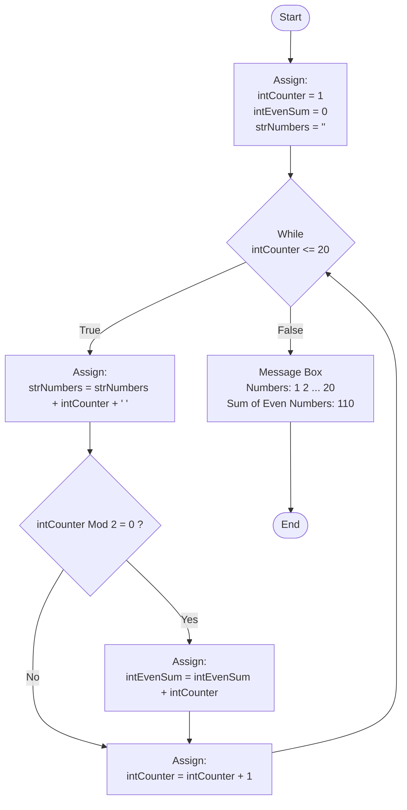

# Exercise 7: Number Processing Using While Loop

## 1. Aim
To develop a UiPath workflow to iterate through numbers 1 to 20, construct a concatenated string of numbers, and calculate the sum of all even numbers using a **While** loop.

---

## 2. Workflow Specifications
- **Software**: UiPath Studio
- **Project Type**: Windows (.NET 6 / .NET 8 / .NET 10)
- **Expression Language**: VB.NET
- **Workflow Type**: `Sequence`
- **Dependencies**: `UiPath.System.Activities`, `UiPath.UIAutomation.Activities`

---

## 3. Variables & Data Types

| Variable Name | Data Type | Default Value | Scope | Description |
| :--- | :--- | :--- | :--- | :--- |
| `intCounter` | `System.Int32` | `1` | Main Sequence | Loop iteration counter incremented from 1 to 20. |
| `intEvenSum` | `System.Int32` | `0` | Main Sequence | Accumulator variable storing the sum of all even numbers. |
| `strNumbers` | `System.String` | `""` | Main Sequence | Formatted string containing all traversed numbers separated by space. |

---

## 4. Mathematical Formulation
- Traversed sequence: $S = \{1, 2, 3, \dots, 20\}$
- Even condition: $x \pmod 2 = 0$
- Even numbers: $\{2, 4, 6, 8, 10, 12, 14, 16, 18, 20\}$
- Sum formula:
  $$\sum_{k=1}^{10} 2k = 2 	imes rac{10 	imes 11}{2} = 110$$

---

## 5. Step-by-Step Procedure

1. **Initialize Loop Variables**:
   - In `Main.xaml`, add a **Sequence** activity.
   - Add **Assign** activities:
     - `intCounter = 1`
     - `intEvenSum = 0`
     - `strNumbers = ""`

2. **While Activity**:
   - Add an **Interruptible While** activity:
     - **Condition**:
       ```vb
       intCounter <= 20
       ```

3. **Loop Body Actions**:
   - Inside the While loop body:
     1. **Append Current Number**:
        - Assign: `strNumbers = strNumbers & intCounter.ToString() & " "`
     2. **Check for Even Number**:
        - Add an **If** activity with condition:
          ```vb
          intCounter Mod 2 = 0
          ```
        - **Then Branch**:
          - Assign: `intEvenSum = intEvenSum + intCounter`
     3. **Increment Loop Counter**:
        - Assign: `intCounter = intCounter + 1`

4. **Display Output**:
   - After the While loop, add a **Message Box** activity with the expression:
     ```vb
     "Numbers: " & strNumbers & vbCrLf & _
     "Sum of Even Numbers: " & intEvenSum.ToString()
     ```

---

## 6. Workflow Architecture Diagram



---

## 7. How to Open and Run in UiPath Studio

1. Open UiPath Studio.
2. Select **Open Project** and navigate to `d:\7sem\rpa\experiment\Exercise_07_Number_Processing_While_Loop`.
3. Open `Main.xaml`.
4. Press `F6` (**Run File**).
5. The Message Box displays the full list of numbers and the computed even sum.

---

## 8. Execution Results

```text
Numbers: 1 2 3 4 5 6 7 8 9 10 11 12 13 14 15 16 17 18 19 20 
Sum of Even Numbers: 110
```

---

## 9. Key RPA Concepts Demonstrated
- **Entry-Controlled Loops (`While`)**: Executing loops based on a pre-condition evaluated before each iteration.
- **Loop Invariants & Counters**: Manually incrementing state variables to ensure reliable loop termination.
- **Arithmetic Operators (`Mod`)**: Utilizing modulo arithmetic to detect parity of integer values.\n