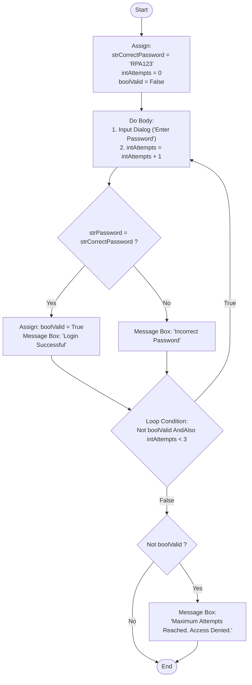

# Exercise 8: Password Validation Using Do While

## 1. Aim
To develop a UiPath workflow to validate a user password using an exit-controlled **Do While** loop, allowing a maximum of three attempts before denying access.

---

## 2. Workflow Specifications
- **Software**: UiPath Studio
- **Project Type**: Windows (.NET 6 / .NET 8 / .NET 10)
- **Expression Language**: VB.NET
- **Workflow Type**: `Sequence`
- **Dependencies**: `UiPath.System.Activities`, `UiPath.UIAutomation.Activities`

---

## 3. Variables & Data Types

| Variable Name | Data Type | Default Value | Scope | Description |
| :--- | :--- | :--- | :--- | :--- |
| `strPassword` | `System.String` | *(None)* | Main Sequence | User input password entered via Input Dialog. |
| `strCorrectPassword` | `System.String` | `"RPA123"` | Main Sequence | Target demonstration password. |
| `intAttempts` | `System.Int32` | `0` | Main Sequence | Counter tracking the number of password attempts made. |
| `boolValid` | `System.Boolean` | `False` | Main Sequence | State flag set to True when authentication succeeds. |

---

## 4. Step-by-Step Procedure

1. **Initialize State Variables**:
   - In `Main.xaml`, add a **Sequence** activity.
   - Add **Assign** activities:
     - `strCorrectPassword = "RPA123"`
     - `intAttempts = 0`
     - `boolValid = False`

2. **Do While Activity**:
   - Add an **Interruptible Do While** activity:
     - **Condition**:
       ```vb
       Not boolValid AndAlso intAttempts < 3
       ```

3. **Loop Body Sequence**:
   - Inside the Do While body:
     1. **Prompt for Password**:
        - Add an **Input Dialog** activity:
          - Title: `"Password Validation"`
          - Label: `"Enter Password"`
          - Result: `strPassword`
     2. **Increment Counter**:
        - Assign: `intAttempts = intAttempts + 1`
     3. **Validate Password**:
        - Add an **If** activity with condition:
          ```vb
          strPassword = strCorrectPassword
          ```
        - **Then Branch**:
          - Assign: `boolValid = True`
          - Message Box: `"Login Successful"`
        - **Else Branch**:
          - Message Box: `"Incorrect Password"`

4. **Post-Loop Access Denied Check**:
   - After the Do While activity, add an **If** activity:
     - **Condition**:
       ```vb
       Not boolValid
       ```
     - **Then Branch**:
       - Message Box: `"Maximum Attempts Reached. Access Denied."`

---

## 5. Workflow Architecture Diagram



---

## 6. How to Open and Run in UiPath Studio

1. Open UiPath Studio.
2. Select **Open Project** and navigate to `d:\7sem\rpa\experiment\Exercise_08_Password_Validation_Do_While`.
3. Open `Main.xaml`.
4. Press `F6` (**Run File**).
5. Test Scenario A: Enter `RPA123` on attempt 1 $
ightarrow$ `"Login Successful"`.
6. Test Scenario B: Enter incorrect passwords 3 times $
ightarrow$ `"Maximum Attempts Reached. Access Denied."`.

---

## 7. Test Cases & Execution Results

| Test Case | Attempt 1 | Attempt 2 | Attempt 3 | Intermediary Dialogs | Final Dialog | Result |
| :---: | :---: | :---: | :---: | :--- | :--- | :---: |
| **TC-01** | `RPA123` | *N/A* | *N/A* | *None* | `Login Successful` | ✅ Success |
| **TC-02** | `wrong1` | `RPA123` | *N/A* | `Incorrect Password` | `Login Successful` | ✅ Success |
| **TC-03** | `abc` | `def` | `RPA123` | `Incorrect Password` (x2) | `Login Successful` | ✅ Success |
| **TC-04** | `111` | `222` | `333` | `Incorrect Password` (x3) | `Maximum Attempts Reached. Access Denied.` | ❌ Denied |

---

## 8. Key RPA Concepts Demonstrated
- **Exit-Controlled Loops (`Do While`)**: Guaranteeing that the user authentication prompt executes at least once regardless of initial state.
- **Compound Loop Termination Conditions**: Combining state flags and numeric thresholds with `AndAlso`.
- **Security Demonstration Note**: Plain text hardcoded credentials are for classroom demonstration only; production RPA bots utilize UiPath Orchestrator Assets (Credentials) and SecureString encryption.\n