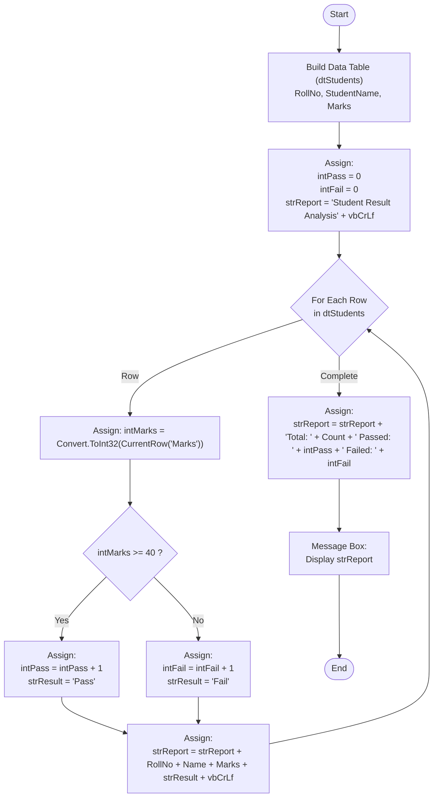

# Exercise 9: Student Result Analysis Using DataTable

## 1. Aim
To develop a UiPath workflow to classify student results into Pass/Fail based on a cutoff mark of **40**, calculate summary statistics, and generate a comprehensive result analysis report using a `DataTable`.

---

## 2. Workflow Specifications
- **Software**: UiPath Studio
- **Project Type**: Windows (.NET 6 / .NET 8 / .NET 10)
- **Expression Language**: VB.NET
- **Workflow Type**: `Sequence`
- **Dependencies**: `UiPath.System.Activities`, `UiPath.UIAutomation.Activities`

---

## 3. Variables & Data Types

| Variable Name | Data Type | Default Value | Scope | Description |
| :--- | :--- | :--- | :--- | :--- |
| `dtStudents` | `System.Data.DataTable` | *(None)* | Main Sequence | In-memory table holding student roll numbers, names, and marks. |
| `intPass` | `System.Int32` | `0` | Main Sequence | Counter tracking number of passed students. |
| `intFail` | `System.Int32` | `0` | Main Sequence | Counter tracking number of failed students. |
| `intMarks` | `System.Int32` | `0` | Main Sequence | Numerical marks extracted from the current record row. |
| `strResult` | `System.String` | *(None)* | Main Sequence | Classification result for current student (`"Pass"` or `"Fail"`). |
| `strReport` | `System.String` | *(None)* | Main Sequence | Textual report string summarizing all results and counts. |

---

## 4. Student Dataset Schema & Expected Classification

| RollNo (Int32) | StudentName (String) | Marks (Int32) | Classification (Marks >= 40) |
| :---: | :---: | :---: | :---: |
| `101` | Arun | `85` | Pass |
| `102` | Bala | `32` | Fail |
| `103` | Charan | `67` | Pass |
| `104` | Divya | `28` | Fail |
| `105` | Ezhil | `74` | Pass |

---

## 5. Step-by-Step Procedure

1. **Build Data Table Activity**:
   - Add a **Build Data Table** activity:
     - Columns: `RollNo` (Int32), `StudentName` (String), `Marks` (Int32).
     - Populate with the five student records listed in Section 4.
     - Set Output DataTable to `dtStudents`.

2. **Initialize Counters & Report Header**:
   - Add **Assign** activities:
     - `intPass = 0`
     - `intFail = 0`
     - `strReport = "Student Result Analysis" & vbCrLf`

3. **Iterate with For Each Row in Data Table**:
   - Add a **For Each Row in Data Table** activity:
     - **DataTable**: `dtStudents`
     - **CurrentRow**: `CurrentRow`

4. **Row Evaluation**:
   - Inside the loop body:
     1. Assign: `intMarks = Convert.ToInt32(CurrentRow("Marks"))`
     2. Add an **If** activity with condition:
        ```vb
        intMarks >= 40
        ```
        - **Then Branch**:
          - Assign: `intPass = intPass + 1`
          - Assign: `strResult = "Pass"`
        - **Else Branch**:
          - Assign: `intFail = intFail + 1`
          - Assign: `strResult = "Fail"`
     3. Append student record to report:
        ```vb
        strReport = strReport & CurrentRow("RollNo").ToString() & " - " & _
                    CurrentRow("StudentName").ToString() & " - " & _
                    intMarks.ToString() & " - " & strResult & vbCrLf
        ```

5. **Append Summary Totals**:
   - After the loop completes, add an **Assign** activity:
     ```vb
     strReport = strReport & "Total: " & dtStudents.Rows.Count.ToString() & _
                 " Passed: " & intPass.ToString() & _
                 " Failed: " & intFail.ToString()
     ```

6. **Display Report**:
   - Add a **Message Box** activity with Text: `strReport`.

---

## 6. Workflow Architecture Diagram



---

## 7. How to Open and Run in UiPath Studio

1. Open UiPath Studio.
2. Select **Open Project** and navigate to `d:\7sem\rpa\experiment\Exercise_09_Student_Result_Analysis_DataTable`.
3. Open `Main.xaml`.
4. Press `F6` (**Run File**).
5. Inspect the generated report in the Message Box.

---

## 8. Execution Results

```text
Student Result Analysis
101 - Arun - 85 - Pass
102 - Bala - 32 - Fail
103 - Charan - 67 - Pass
104 - Divya - 28 - Fail
105 - Ezhil - 74 - Pass
Total: 5 Passed: 3 Failed: 2
```

---

## 9. Key RPA Concepts Demonstrated
- **DataTable Schema Definition**: Strong typing of schema columns with integer and string formats.
- **Aggregation & Counting**: Accumulating conditional category counts during tabular traversal.
- **Comprehensive Textual Reporting**: Constructing well-structured multi-line business reports from tabular datasets.\n