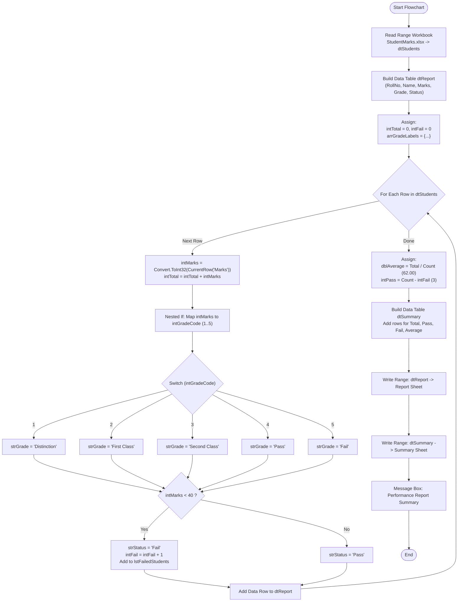

# Exercise 10: Student Performance Report Automation Using Excel

## 1. Aim
To develop an automated UiPath workflow using a **Flowchart** that reads student marks from an Excel file (`StudentMarks.xlsx`), categorizes grades using a **Switch** activity, determines pass/fail status, generates statistical summaries, and writes an Excel performance report workbook (`StudentPerformanceReport.xlsx`).

---

## 2. Workflow Specifications
- **Software**: UiPath Studio
- **Project Type**: Windows (.NET 6 / .NET 8 / .NET 10)
- **Expression Language**: VB.NET
- **Workflow Type**: `Flowchart`
- **Dependencies**: `UiPath.Excel.Activities`, `UiPath.System.Activities`, `UiPath.UIAutomation.Activities`
- **Input File**: `StudentMarks.xlsx` (Sheet: `Sheet1`)
- **Output File**: `StudentPerformanceReport.xlsx` (Sheets: `Report` and `Summary`)

---

## 3. Variables & Data Types

| Variable Name | Data Type | Default Value | Scope | Description |
| :--- | :--- | :--- | :--- | :--- |
| `dtStudents` | `System.Data.DataTable` | *(None)* | Flowchart | Input data table read from `StudentMarks.xlsx`. |
| `dtReport` | `System.Data.DataTable` | *(None)* | Flowchart | Output performance report table with grades and status. |
| `dtSummary` | `System.Data.DataTable` | *(None)* | Flowchart | Output summary metrics table. |
| `intMarks` | `System.Int32` | *(None)* | Flowchart | Current student's marks. |
| `intTotal` | `System.Int32` | `0` | Flowchart | Accumulator for total class marks. |
| `intFail` | `System.Int32` | `0` | Flowchart | Count of failed students. |
| `intPass` | `System.Int32` | `0` | Flowchart | Count of passed students. |
| `intGradeCode` | `System.Int32` | *(None)* | Flowchart | Integer code (1-5) mapping to grade labels. |
| `dblAverage` | `System.Double` | `0` | Flowchart | Calculated class average marks. |
| `strGrade` | `System.String` | *(None)* | Flowchart | Assigned grade label. |
| `strStatus` | `System.String` | *(None)* | Flowchart | Assigned pass/fail status (`"Pass"` or `"Fail"`). |
| `lstFailedStudents`| `List(Of String)` | *(None)* | Flowchart | Collection holding names of students who failed. |
| `arrGradeLabels` | `String[]` | *(Array)* | Flowchart | Array of grade strings: `{"Distinction", "First Class", "Second Class", "Pass", "Fail"}`. |

---

## 4. Grading Criteria & Grade Code Mapping

| Marks Range | Grade Code (`intGradeCode`) | Grade Label (`strGrade`) | Status (`strStatus`) |
| :---: | :---: | :--- | :---: |
| **>= 75** | `1` | `arrGradeLabels(0)` = **Distinction** | Pass |
| **60 – 74** | `2` | `arrGradeLabels(1)` = **First Class** | Pass |
| **50 – 59** | `3` | `arrGradeLabels(2)` = **Second Class** | Pass |
| **40 – 49** | `4` | `arrGradeLabels(3)` = **Pass** | Pass |
| **< 40** | `5` | `arrGradeLabels(4)` = **Fail** | Fail |

---

## 5. Input Data (`StudentMarks.xlsx`)

Located in the project root directory:

| RollNo | StudentName | Marks |
| :---: | :--- | :---: |
| 101 | Arun | 85 |
| 102 | Bala | 35 |
| 103 | Charan | 72 |
| 104 | Divya | 28 |
| 105 | Ezhil | 90 |

---

## 6. Step-by-Step Procedure

1. **Input Excel File Preparation**:
   - The file `StudentMarks.xlsx` contains columns `RollNo`, `StudentName`, and `Marks` with the 5 records above.

2. **Flowchart Structure**:
   - In `Main.xaml`, create a **Flowchart** activity named `Flowchart - Student Performance Report`.
   - Connect **StartNode** to FlowStep 1 (`Process Marks and Generate Reports` Sequence).

3. **Read Range Activity**:
   - Add a **Read Range** (Workbook) activity:
     - **WorkbookPath**: `"StudentMarks.xlsx"`
     - **SheetName**: `"Sheet1"`
     - **AddHeaders**: `True`
     - **DataTable**: `dtStudents`

4. **Build Data Table (`dtReport`)**:
   - Add a **Build Data Table** activity with columns:
     - `RollNo` (`Int32`)
     - `StudentName` (`String`)
     - `Marks` (`Int32`)
     - `Grade` (`String`)
     - `Status` (`String`)

5. **Initialize Accumulators & Collections**:
   - Assign `intTotal = 0`
   - Assign `intFail = 0`
   - Assign `lstFailedStudents = New List(Of String)()`
   - Assign `arrGradeLabels = New String() {"Distinction", "First Class", "Second Class", "Pass", "Fail"}`

6. **Iterate with For Each Row in Data Table**:
   - Inside the loop over `dtStudents`:
     1. Assign: `intMarks = Convert.ToInt32(CurrentRow("Marks"))`
     2. Assign: `intTotal = intTotal + intMarks`
     3. Nested If block to map `intMarks` to `intGradeCode` (1 to 5).
     4. Add **Switch(Of Int32)** activity with expression `intGradeCode`:
        - Case 1: `strGrade = arrGradeLabels(0)`
        - Case 2: `strGrade = arrGradeLabels(1)`
        - Case 3: `strGrade = arrGradeLabels(2)`
        - Case 4: `strGrade = arrGradeLabels(3)`
        - Case 5: `strGrade = arrGradeLabels(4)`
        - Default: `strGrade = "Invalid"`
     5. Check pass/fail status:
        - If `intMarks < 40`:
          - Assign `strStatus = "Fail"`
          - Assign `intFail = intFail + 1`
          - `AddToCollection`: `lstFailedStudents`, `CurrentRow("StudentName").ToString()`
        - Else:
          - Assign `strStatus = "Pass"`
     6. Add Data Row to `dtReport`:
        - ArrayRow: `New Object() {Convert.ToInt32(CurrentRow("RollNo")), CurrentRow("StudentName").ToString(), intMarks, strGrade, strStatus}`

7. **Compute Overall Statistics & Summary Table**:
   - After the loop:
     - Assign: `dblAverage = If(dtStudents.Rows.Count > 0, CDbl(intTotal) / Math.Max(1, dtStudents.Rows.Count), 0)`
     - Assign: `intPass = dtStudents.Rows.Count - intFail`
   - Build Data Table `dtSummary` with columns `Metric` (`String`) and `Value` (`String`).
   - Add data rows to `dtSummary`:
     - `{"Total Students", dtStudents.Rows.Count.ToString()}`
     - `{"Passed", intPass.ToString()}`
     - `{"Failed", intFail.ToString()}`
     - `{"Class Average", dblAverage.ToString("F2")}`

8. **Write Range Activities**:
   - Write `dtReport` to `StudentPerformanceReport.xlsx`, Sheet `"Report"`, AddHeaders = `True`.
   - Write `dtSummary` to `StudentPerformanceReport.xlsx`, Sheet `"Summary"`, AddHeaders = `True`.

9. **Completion Dialog Node**:
   - Connect FlowStep 1 to FlowStep 2 containing a **Message Box**:
     ```vb
     "Student Performance Report Automation" & vbCrLf & vbCrLf & _
     "Total Students: " & dtStudents.Rows.Count.ToString() & vbCrLf & _
     "Passed: " & intPass.ToString() & vbCrLf & _
     "Failed: " & intFail.ToString() & vbCrLf & _
     "Class Average: " & dblAverage.ToString("F2") & vbCrLf & vbCrLf & _
     "Report saved to: StudentPerformanceReport.xlsx"
     ```

---

## 7. Workflow Architecture Diagram



---

## 8. How to Open and Run in UiPath Studio

1. Open UiPath Studio.
2. Select **Open Project** and navigate to `d:\7sem\rpa\experiment\Exercise_10_Student_Performance_Report_Excel`.
3. Verify that `StudentMarks.xlsx` exists in the folder.
4. Open `Main.xaml`.
5. Press `F6` (**Run File**).
6. Observe the completion Message Box.
7. Open the generated `StudentPerformanceReport.xlsx` file in Microsoft Excel or any spreadsheet viewer.

---

## 9. Execution Results & Generated Workbook

### Message Box Output:
```text
Student Performance Report Automation

Total Students: 5
Passed: 3
Failed: 2
Class Average: 62.00

Report saved to: StudentPerformanceReport.xlsx
```

### Sheet 1: `Report`
| RollNo | StudentName | Marks | Grade | Status |
| :---: | :--- | :---: | :--- | :---: |
| 101 | Arun | 85 | Distinction | Pass |
| 102 | Bala | 35 | Fail | Fail |
| 103 | Charan | 72 | First Class | Pass |
| 104 | Divya | 28 | Fail | Fail |
| 105 | Ezhil | 90 | Distinction | Pass |

### Sheet 2: `Summary`
| Metric | Value |
| :--- | :--- |
| Total Students | 5 |
| Passed | 3 |
| Failed | 2 |
| Class Average | 62.00 |

---

## 10. Key RPA Concepts Demonstrated
- **Excel Automation**: End-to-end reading, transformation, and multi-sheet writing without requiring interactive user intervention.
- **Switch with Numeric Codes**: Utilizing normalized integer codes to select grade titles dynamically from an array.
- **Data Aggregation**: Computing sums, averages, and pass/fail counts over dynamic sets.
- **Reporting Architecture**: Generating professional multi-sheet workbooks with detailed records on one tab and executive KPI summaries on another.\n